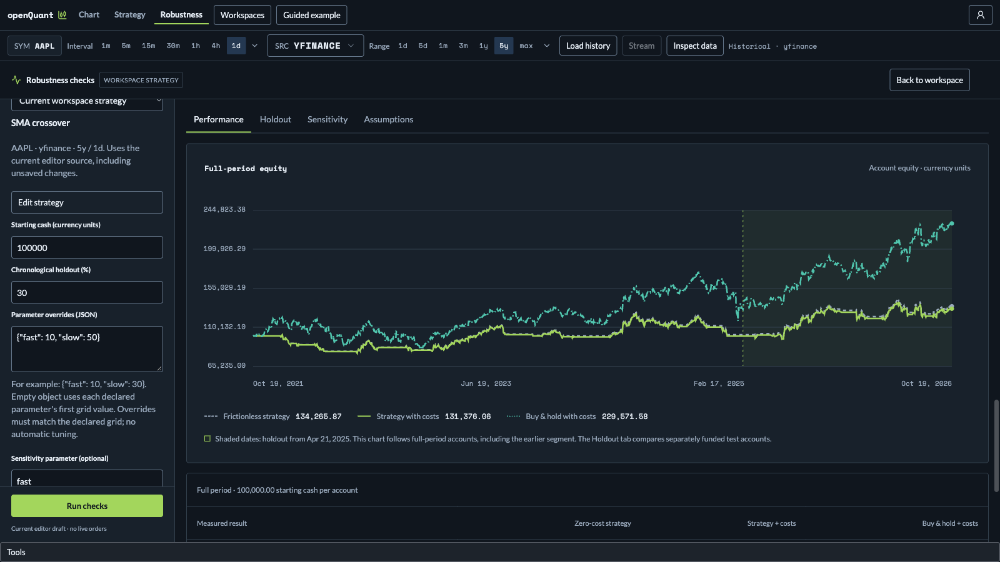

# Robustness checks

Open **Robustness** from the workspace header or Strategy editor to check the current strategy draft (including unsaved changes) on the selected provider, symbol, period and interval. Sign in for workspace runs. The configuration sidebar supports execution costs, starting cash, a chronological holdout percentage, JSON parameter overrides and one sensitivity parameter. Measured findings precede the detailed Performance, Holdout, Sensitivity and Assumptions tabs. The completed report shows its original data context and expandable source/data SHA-256 provenance, engine, parameters and local receipt time, even if current inputs change. Local HTML exports omit source code, and public links only support synthetic examples. Saved strategies work by opening them in the editor first.

Workspace checks reuse one provider/cache OHLCV snapshot, not the live chart stream. Parameters default to their first declared grid value unless overridden; no optimization is performed. Sensitivity measures immediate declared-grid neighbors (Choice uses declaration order), holding all other parameters fixed. Holdout starts with fresh cash, strategy/module state and no earlier indicator history. A chronological split **cannot prove dates were unseen during your research**. The suite is single-symbol only, allows 40–10,000 bars with at least 20 per segment, at most 1,000 grid values per parameter, two concurrent suites per server process, and a 30-second whole-suite timeout. Stopping the browser's wait does not terminate server computation; it remains timeout-bounded. Data hashes identify evaluated bars but do not permanently store them; no provider data licensing or production multi-tenant security claim is made.
